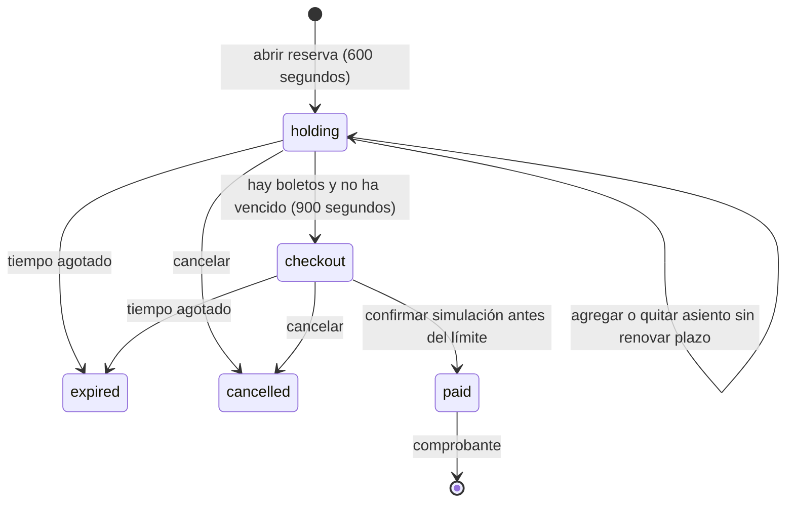
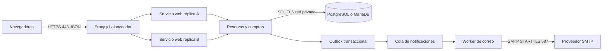

# Arquitectura y evolución distribuida

## Planteamiento
Una agencia ofrece cinco vuelos desde Ciudad de México. Varios clientes pueden consultar y reservar a la vez, pero cada asiento debe tener como máximo un propietario activo. El sistema debe mantener consistencia entre selección, compra y comprobante, incluso ante vencimientos o solicitudes repetidas.

## Implementación local
Monolito modular con interfaz web y API JSON en un servidor Flask. SQLite está en el mismo equipo. No se implementan microservicios ni RPC en esta entrega. El navegador y el servidor son procesos separados que se comunican por HTTP/TCP en loopback. Los módulos Python se llaman dentro del mismo proceso. SQLite se integra como biblioteca y usa archivos y bloqueos del sistema operativo; no tiene servidor SQL remoto.

Los importes son enteros en centavos. El cliente muestra valores, pero el servidor calcula y conserva la tarifa de cada boleto. La cookie de sesión está firmada; no contiene la contraseña. Las contraseñas se guardan mediante el hash de Werkzeug; cada modificación requiere token CSRF. Consultas parametrizadas y texto del DOM insertado con textContent evitan interpretar entradas como SQL o HTML. Los comprobantes y las operaciones exigen propietario autenticado.

## Modelo relacional
- users: id PK, name, email UNIQUE, password (hash).
- flights: id PK, destination, kind, departure ISO con zona, adult/child/senior/first (centavos), discount (%).
- seats: PK compuesta (flight_id, number), FK a flights, cabin.
- bookings: id UUID PK, user_id FK, flight_id FK, trip, status, expires/created/paid_at (epoch UTC), total (centavos), method.
- tickets: PK (booking_id, seat), FK a bookings, FK compuesta a seats, category, amount (centavos), active.

users 1:N bookings; flights 1:N bookings; flights 1:30 seats; bookings 1:N tickets; seats 1:N tickets históricos, pero 0:1 activos. El índice único parcial (flight_id, seat) WHERE active=1 impide dos propietarios activos. Los boletos históricos liberados conservan active=0. En servicio distribuido se debe reforzar también la coherencia entre el flight_id de bookings y tickets; las rutas actuales siempre lo obtienen del servidor.

## Máquina de estados y concurrencia

La operación abre BEGIN IMMEDIATE, libera reservas vencidas, comprueba propietario/estado/plazo, verifica o actualiza asientos y confirma. Una segunda conexión espera hasta 10 segundos por el escritor; después recibe un error recuperable 503 si persiste la contención. El índice único es una segunda barrera. El límite es expires <= ahora: exactamente en el vencimiento ya no se puede comprar.

La liberación es perezosa: se ejecuta al consultar disponibilidad/reservas o modificar una reserva. No se necesita mantener un temporizador por usuario en memoria. Cuando no hay tráfico pueden existir registros vencidos todavía marcados activos; la siguiente operación los limpia antes de decidir disponibilidad. Si una operación termina con error y revierte, la limpieza también revierte; la siguiente consulta u operación válida la reaplica. No concede extensión ni permite compra tardía. La pantalla consulta cada 5 segundos, por lo que puede mostrar información ligeramente anterior; la autoridad es el servidor.

WAL permite coexistencia de lectores y escritor, pero esta versión usa transacciones de escritura incluso para las consultas con limpieza: esas consultas se serializan brevemente. No se afirma paralelismo ilimitado de lectura. La demo prioriza corrección; separar una tarea de limpieza y lecturas puras sería una optimización posterior.

Pago repetido sobre el mismo folio devuelve éxito sin crear otro cargo ni correo. SMTP se ejecuta después del commit para no mantener bloqueos durante la red. Una caída entre commit y correo puede perder el envío; el comprobante permanece descargable. No hay reintentos automáticos ni promesa de entrega exactamente una vez.

## Contrato HTTP
| Método y ruta | Entrada / resultado |
|---|---|
| GET /api/session | usuario, token CSRF y hora del servidor |
| POST /api/register | name, email, password; 201 o 409 |
| POST /api/login | email, password; cookie de sesión |
| POST /api/logout | cierra sesión |
| GET /api/flights | catálogo público, tarifas y disponibilidad |
| GET /api/flights/:id/seats | número, cabina, estado y marca mine |
| POST /api/bookings | flight, trip=oneway/roundtrip; folio |
| GET /api/bookings | reservas propias y boletos |
| POST /api/bookings/:id/seats | seat entero, category=adult/child/senior, remove opcional |
| POST /api/bookings/:id/checkout | inicia plazo de compra |
| POST /api/bookings/:id/pay | method=efectivo/tarjeta; resultado SMTP |
| POST /api/bookings/:id/cancel | libera reserva no comprada |
| GET /api/bookings/:id/receipt | comprobante TXT privado |

Errores: 400 entrada inválida; 401 sin sesión; 403 CSRF; 404 inexistente o ajeno; 409 conflicto/vencimiento; 503 base ocupada. Las mutaciones requieren X-CSRF-Token obtenido de /api/session. No se acepta total, propietario o tiempo enviados por el cliente.

## Conversión futura a sistema distribuido
Se propone un sistema transaccional cliente-servidor multicapa, con servicios de aplicación replicados y base relacional central. Primera etapa: reemplazar SQLite por PostgreSQL o MariaDB y ejecutar la aplicación bajo servidor WSGI detrás de un proxy HTTPS. Una base cliente-servidor permite conexiones de varios equipos; no se debe montar el archivo SQLite en una carpeta de red.

Segunda etapa: separar catálogo, identidad, reservas/compras y notificaciones. Mantener reservas y compra en el mismo servicio transaccional reduce transacciones distribuidas. Catálogo admite caché; inventario no se confirma a partir de caché. No es obligatorio separar cada archivo Python en microservicio.

Infraestructura propuesta: contenedores para web y worker, volúmenes persistentes solo para la base, red privada para base y cola, DNS de servicios, proxy expuesto en 443. La base usaría 5432 (PostgreSQL) o 3306 (MariaDB) solo internamente; gRPC, si se adopta, podría usar 50051 interno. Separar secretos de imágenes; sincronizar relojes con NTP, usar hora de base para vencimientos, copias de seguridad y restauraciones probadas. Un volumen en una única máquina sigue siendo punto único de falla; alta disponibilidad exige replicación/failover y no se obtiene por usar contenedores.

## Comunicación interprocesos, RPC y protocolos
HTTP/JSON usa solicitud-respuesta entre navegador y backend. Para llamadas internas tipadas se puede incorporar gRPC con Protocol Buffers sobre HTTP/2, por ejemplo ReserveSeats(booking_id, seats, idempotency_key). El cliente utiliza un stub que serializa parámetros; el servidor deserializa, autentica, ejecuta y responde. Establecer deadline explícito, propagar identificadores de correlación y devolver códigos de conflicto. REST sobre HTTPS también basta para esta escala; gRPC es una alternativa de evolución, no una dependencia actual.

Un timeout de red no demuestra que la operación falló: el servidor pudo haber confirmado antes de perder la respuesta. Reintentar con la misma clave de idempotencia y consultar el resultado evita duplicaciones. No ejecutar comandos remotos de shell como sustituto de una API. La invocación remota de procesos debe limitarse a servicios controlados, autenticados y con contratos definidos.

Notificaciones se desacoplan mediante mensajes asíncronos: la compra y un evento outbox se escriben en una misma transacción. Un worker publica/procesa eventos con reintentos limitados, espera progresiva y cola de errores; el consumidor deduplica por event_id. Se acepta entrega al menos una vez y consistencia eventual del correo. La compra mantiene consistencia fuerte y el correo no decide la venta.

## Consistencia, fallos y crecimiento
En MariaDB/PostgreSQL usar transacciones, bloqueo SELECT FOR UPDATE o actualizaciones condicionales e índice único compatible. Adquirir múltiples asientos siempre en orden para reducir deadlocks; si falla uno, revertir el lote. No copiar literalmente el índice parcial de SQLite a MariaDB: usar tabla de asignaciones activas con PK (flight_id,seat) y tabla histórica separada. Añadir migraciones y repetir pruebas concurrentes contra el motor elegido.

Durante una partición de red que impida acceder a la autoridad del inventario, rechazar o posponer compras; vender desde réplicas divergentes arriesga sobreventa. El catálogo puede seguir disponible con caché y aviso de actualización pendiente. Un futuro pago real requeriría saga: retener asiento, autorizar pago, confirmar, y compensar o reembolsar si falla la confirmación. Ese flujo no está implementado.

Escalabilidad horizontal de web necesita clave de sesión compartida y política de revocación, límites de solicitudes, TLS, control de acceso entre servicios y observabilidad. Medir latencia p95, conflictos, bloqueos, cola de correos y errores. Probar caída del worker, pérdida de respuesta tras commit, agotamiento del pool de conexiones y recuperación de copias. No se afirma cumplimiento de producción ni tolerancia total a fallos.

## Planeación y trabajo
1. Acordar requisitos y registrar ambigüedades con el docente.
2. Texis define esquema/semillas con León; Vera valida fórmula de tarifas.
3. Josué conecta pantallas y autenticación con contratos JSON acordados.
4. León implementa transacciones/estados; Vera integra confirmación/recibos.
5. Todos ejecutan pruebas y revisan cambios antes de integrar.
6. Ensayar plenaria con dos sesiones y preparar respaldo local.

## Conclusiones
La entrega demuestra exclusión de asientos, persistencia y un flujo de compra simulado verificable. SQLite simplifica ejecución local, aunque limita escritores concurrentes. La evolución distribuida debe preservar una autoridad transaccional de inventario, manejar reintentos e idempotencia y desacoplar correo. La interpretación del descuento y los datos de regreso requieren validación antes de considerar el modelo comercial definitivo.

## Fuentes
- Consigna local T1_T2ProyectoVuelo.docx, recuperada de Descargas; tabla y requisitos completos revisados.
- Captura de Teams: Proyecto T1yT2; vencimiento 15/10/2026 23:59; admite implementación local y solicita análisis distribuido.
- Flask: https://flask.palletsprojects.com/en/stable/installation/
- SQLite, transacciones: https://www.sqlite.org/lang_transaction.html
- SQLite, usos y red: https://www.sqlite.org/whentouse.html
- gRPC, conceptos y ciclo: https://grpc.io/docs/what-is-grpc/core-concepts/
- gRPC, deadlines: https://grpc.io/docs/guides/deadlines/
